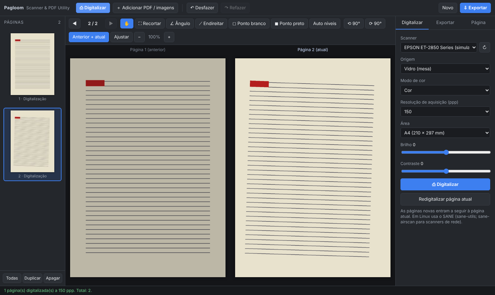
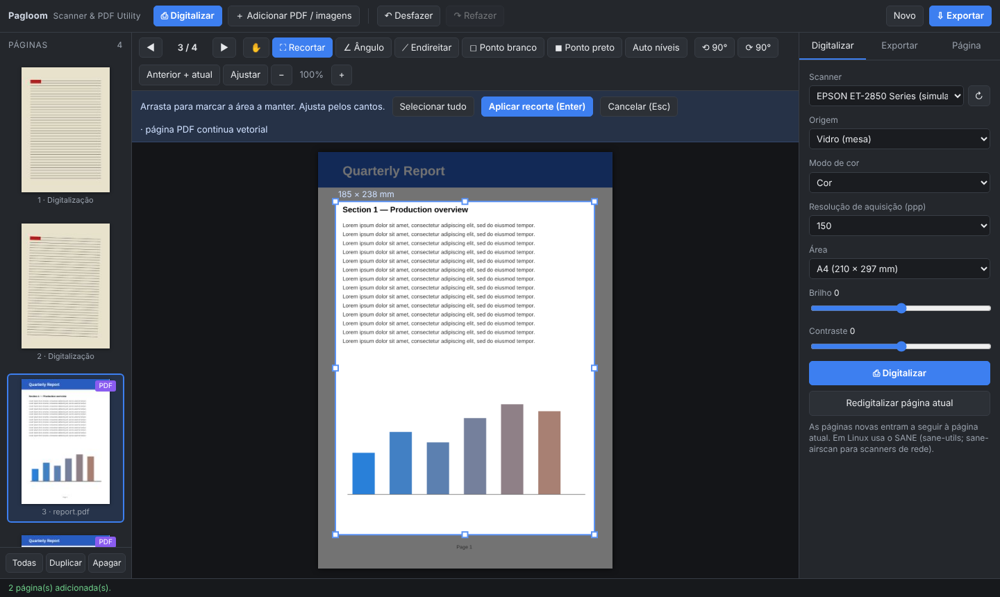
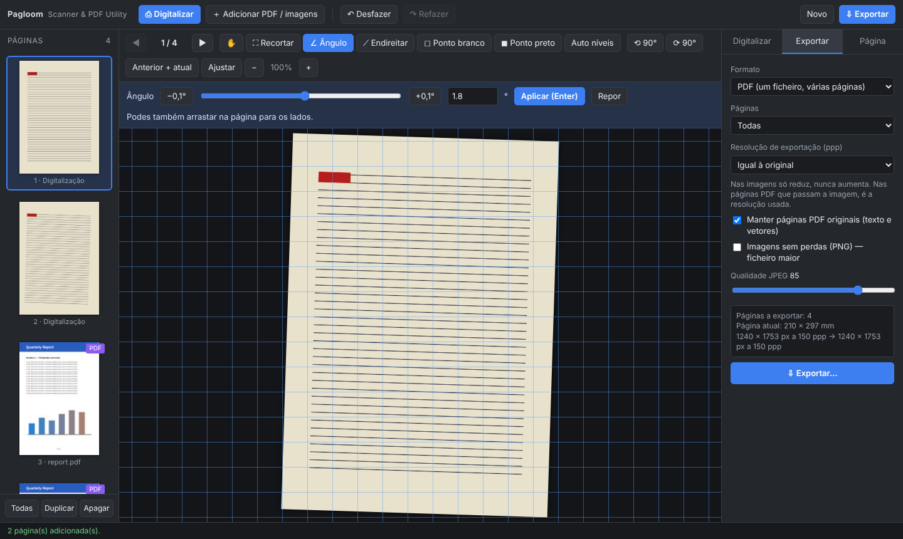

# Pagloom — Scanner & PDF Utility

*English version: [README.md](README.md)*

**[⬇ Descarregar a versão mais recente](https://github.com/3devangelist/pagloom/releases/latest)** — Windows (`.zip`) e Linux (`.AppImage`).

| Digitalizar, página anterior + atual | Recortar uma página PDF (continua vetorial) | Rotação por ângulo e exportação |
|---|---|---|
|  |  |  |

**Pagloom** é uma aplicação para digitalizar documentos, editar as páginas e juntar tudo, incluindo PDFs já existentes, num único documento.

| | |
|---|---|
| **Feita em** | 11 de outubro de 2026 |
| **Pedida e orientada por** | Ricardo Pereira ([@3devangelist](https://github.com/3devangelist)) |
| **Programada por** | Claude (Anthropic), no Cowork |
| **Sistemas** | Windows 10/11 · Linux (Ubuntu, Debian, Fedora, openSUSE, Arch) · Linux ARM (Raspberry Pi) |
| **Licença** | [MIT](LICENSE) |

---

## Para que serve

- **Digitalizar** folhas no vidro ou no alimentador automático (ADF), incluindo frente e verso, usando o driver do próprio sistema.
- **Ver as páginas à medida que vão sendo digitalizadas**, com a página anterior ao lado da atual quando for útil.
- **Corrigir as páginas**: rodar por qualquer ângulo, endireitar, recortar e acertar o branco e o preto.
- **Juntar PDFs e imagens** às digitalizações e **mudar as páginas de sítio**.
- **Exportar** para PDF, PNG, JPEG, TIFF ou SVG, com a resolução escolhida.

Na prática, resolve num só programa a digitalização e os problemas habituais com PDFs: juntar, reordenar, rodar, recortar e apagar páginas.

---

## Como funciona

### Digitalizar
1. No separador **Digitalizar**, escolhe o scanner, a origem (vidro, ADF, ADF frente e verso), o modo de cor, a **resolução de aquisição** e a área (A4, A5, Carta ou área total). O brilho e o contraste são opcionais.
2. Carrega em **Digitalizar** (ou na tecla Espaço). As páginas novas entram a seguir à página atual.
3. **Redigitalizar página atual** substitui a página que estás a ver.
4. No Windows existe também **Digitalizar com janela do driver**, que abre a janela do próprio fabricante.

### Navegar e organizar
- Miniaturas à esquerda: clicar para abrir, **arrastar para mudar de sítio**. Ctrl+clique e Shift+clique selecionam várias.
- Botões ◀ ▶ ou setas do teclado para mudar de página. A roda do rato também muda de página quando não há zoom.
- **Anterior + atual** mostra a página anterior ao lado da atual.
- **Duplicar**, **Apagar**, **Desfazer** (Ctrl+Z) e **Refazer** (Ctrl+Y).

### Ferramentas de edição
| Ferramenta | Tecla | O que faz |
|---|---|---|
| Mover | H / Esc | Arrastar a página quando há zoom |
| Recortar | C | Marcar a área a manter, ajustar pelos cantos, Enter para aplicar |
| Ângulo | A | Rodar por qualquer ângulo (passos de 0,1°), com grelha para alinhar |
| Endireitar | T | Desenhar uma linha ao longo do texto ou da margem; a página fica direita |
| Ponto branco | W | Clicar numa zona que devia ser branca; as cores são corrigidas a partir daí |
| Ponto preto | K | Clicar numa zona que devia ser preta |
| Auto níveis | — | Correção automática de branco e preto nas páginas selecionadas |
| Rodar 90° | R / L | Roda as páginas selecionadas para a direita ou para a esquerda |

### Adicionar PDFs e imagens
- Botão **Adicionar PDF / imagens** (Ctrl+O), ou arrastar ficheiros do explorador para a janela.
- Aceita PDF, PNG, JPEG, WEBP, GIF e BMP. PDFs protegidos pedem a palavra-passe.
- **As páginas PDF continuam vetoriais** (texto selecionável) quando são movidas, rodadas 90° ou recortadas.
- Ângulo livre, endireitar e níveis convertem essa página em imagem, à resolução escolhida no separador **Página** (300 ppp por omissão).

### Exportar
1. Separador **Exportar**: escolher o formato, as páginas (todas, selecionadas, atual ou intervalo, por ex. `1-3, 5`) e a **resolução de exportação**.
2. Opções do PDF: manter as páginas PDF originais e guardar as imagens em JPEG (com qualidade ajustável) ou sem perdas (PNG).
3. **Exportar…** abre a janela "Guardar como". No fim aparece o link **mostrar na pasta**.

| Formato | Resultado |
|---|---|
| PDF | Um ficheiro com várias páginas |
| TIFF | Um ficheiro com várias páginas (compressão PackBits) |
| PNG / JPEG / SVG | Um ficheiro por página (`nome_001`, `nome_002`, …) |

A resolução de exportação só reduz: nunca aumenta acima da resolução digitalizada. Os ficheiros PNG, JPEG e TIFF guardam a resolução (ppp) correta, para imprimirem no tamanho real.

---

## Instalação

### Windows
1. Extrair `Pagloom.exe` do `.zip`.
2. Na primeira vez: **Mais informações → Executar mesmo assim** (o programa não tem assinatura digital).
3. Precisa do WebView2, que já vem no Windows 11 e na maioria dos Windows 10.

### Linux (Ubuntu, Debian, Fedora…)
```bash
chmod +x Pagloom-x86_64.AppImage   # ou -aarch64 no Raspberry Pi
./Pagloom-x86_64.AppImage
```
Na primeira vez, se faltar o SANE, o programa pergunta se pode instalar e usa o gestor de pacotes do sistema:

| Sistema | Pacotes |
|---|---|
| Ubuntu / Debian (APT) | `sane-utils sane-airscan` |
| Fedora (DNF) | `sane-backends sane-backends-drivers-scanners sane-airscan` |
| openSUSE (Zypper) | `sane-backends sane-airscan` |
| Arch (Pacman) | `sane sane-airscan` |

A palavra-passe é pedida pela janela do sistema (pkexec). Se não houver essa janela, o programa abre um terminal com o comando `sudo` pronto. O `sane-airscan` permite usar scanners de rede, como a EPSON ET-2850, sem driver do fabricante.

---

## Como está construída

```
┌─────────────────────────────── Pagloom ────────────────────────────────┐
│  Interface (HTML + JavaScript)                                         │
│  páginas, ferramentas, pdf.js (ler PDFs), pdf-lib (criar PDFs)         │
├────────────────────────────────────────────────────────────────────────┤
│  Servidor local em Go (127.0.0.1, com chave de acesso)                 │
│  Windows: WIA (driver do Windows) · janela WebView2 · "Guardar como"   │
│  Linux:   SANE (scanimage) · janela Chromium/Chrome ou Firefox · zenity│
└────────────────────────────────────────────────────────────────────────┘
```

- A interface é a mesma em todos os sistemas. Só a camada que fala com o scanner e com as janelas do sistema muda.
- O programa é um único executável, com a interface e as bibliotecas embutidas.
- As digitalizações ficam numa pasta temporária, que é apagada ao fechar. As definições ficam guardadas em `%APPDATA%\Pagloom` (Windows) ou `~/.config/Pagloom` (Linux).

---

## Compilar a partir do código

Requisitos: **Go 1.24 ou mais recente** e `curl`, num Linux (os AppImages só se criam em Linux).

```bash
bash build.sh
```

O script cria em `dist/`:
- `Pagloom.exe` (Windows x86_64)
- `Pagloom-x86_64.AppImage` e `Pagloom-aarch64.AppImage` (Linux)

Na primeira vez, o script descarrega as bibliotecas JavaScript (`fetch-libs.sh`: pdf.js e pdf-lib, do registo npm, para `web/lib/`), as dependências Go (`go mod tidy`), e o `appimagetool` com os runtimes do AppImage para `build/tools/`.

Só para Windows, também a partir de Windows:
```bash
bash fetch-libs.sh   # ou descarregar à mão os ficheiros indicados nele
go mod tidy
go build -trimpath -ldflags "-H windowsgui -s -w" -o Pagloom.exe .
```

As Releases são criadas automaticamente pelo GitHub Actions (`.github/workflows/release.yml`): ao enviar uma tag como `v1.1.0`, o workflow compila os três ficheiros e publica a Release.

Para testar a interface sem scanner, há um scanner simulado:
```bash
bash fetch-libs.sh
PAGLOOM_MOCK=1 go run .
```

### Estrutura do repositório
```
main.go            servidor local, API, arranque
types.go           tipos e funções comuns
wia_windows.go     scanner no Windows (WIA)
ui_windows.go      janela WebView2 e "Guardar como" no Windows
sane_linux.go      scanner no Linux (SANE / scanimage)
ui_linux.go        janela, "Guardar como" e "mostrar na pasta" no Linux
deps_linux.go      deteção e instalação das dependências (apt, dnf, zypper, pacman)
mock.go            scanner simulado para testes
web/               interface (index.html, style.css, app.js); web/lib/ é preenchida pelo fetch-libs.sh
fetch-libs.sh      descarrega o pdf.js e o pdf-lib
build.sh           compilação e criação dos AppImages
docs/              capturas de ecrã e imagem de pré-visualização
.github/           workflow de Releases e modelos de Issues
```

---

## Ferramentas usadas

| Ferramenta | Para quê |
|---|---|
| **Go 1.24** | Programa principal, servidor local, compilação para Windows e Linux (x86_64 e ARM) |
| **go-ole** | Acesso ao WIA (Windows Image Acquisition) por COM |
| **go-webview2** | Janela com o motor do Edge (WebView2) no Windows |
| **WIA** | Driver de scanners do Windows |
| **SANE / scanimage** | Driver de scanners do Linux |
| **pdf.js** (Mozilla, Apache-2.0) | Ler e mostrar PDFs |
| **pdf-lib** (MIT) | Criar PDFs, copiar páginas vetoriais, rodar e recortar |
| **HTML5 Canvas** | Rotação, recorte, níveis, miniaturas |
| **zenity / kdialog / pkexec** | Janelas do Linux ("Guardar como", perguntas, palavra-passe) |
| **appimagetool** | Criação dos AppImages |
| **Playwright + Chromium** | Testes automáticos da interface |
| **Python (Pillow, pypdf, img2pdf)** | Verificação dos ficheiros exportados e o script `pngs_para_pdf.py` |

### Antes desta versão
1. **`Digitalizador.hta`**: primeira versão em HTML para Windows, com o motor antigo do Internet Explorer. Ficou abandonada por problemas com a lista de scanners e com a exportação para PDF.
2. **`pngs_para_pdf.py`**: script em Python para juntar todos os PNG de uma pasta num PDF, como solução de recurso.
3. **Pagloom (esta versão)**: programa nativo para Windows e Linux.

### Limitações conhecidas
- Testado com scanner simulado. Ainda falta confirmar com a EPSON ET-2850 real.
- Fechar a janela sem exportar perde as páginas, porque ainda não há aviso.
- Não importa ficheiros TIFF, só os exporta. (Alternativa: abrir o TIFF no Fotografias do Windows ou no visualizador de imagens do Linux, gravar como PNG e arrastar o PNG para o Pagloom.)
- Ainda não há versão para macOS.

---

## Regras e pedidos do Ricardo

**Pedido inicial**

1. Software de digitalização de folhas que use o **driver do Windows diretamente**.
2. Mostrar a **página anterior digitalizada**.
3. Poder **passar as páginas para a frente e para trás**.
4. Escolher uma **resolução de aquisição** e uma **resolução de exportação** separadas.
5. Exportar nos formatos mais conhecidos: **PDF, PNG, SVG**, "o que for".
6. Formato **fácil de usar sempre que precisar** (de início, HTML).

**Pedidos seguintes**

7. Ficheiro com extensão `.html` para conseguir descarregar.
8. Script em Python para juntar os PNG de uma pasta num PDF.
9. Resposta direta, sem mexer em nada: dá para funcionar dentro do browser?
10. Passar a aplicação para **EXE**.
11. **Rodar as páginas por ângulo**.
12. **Recortar (crop)**.
13. **Acertar os níveis clicando com o rato na parte branca**.
14. **Adicionar PDFs e mudar as páginas de sítio**, para resolver os problemas com PDFs.
15. Tornar a aplicação independente do sistema operativo.
16. **Versão Linux em AppImage**.
17. **Dependências instaladas na primeira utilização**: por **APT** em Ubuntu/Debian, ou pelo gestor do sistema nos outros.
18. **AppImage para Fedora**.
19. Este documento: para que serve, como funciona, quando e por quem foi feita, ferramentas usadas e regras dadas.

20. **Licença MIT**, para publicar no GitHub.
21. Nome próprio, pesquisado para não existir nem ser parecido com outro: **Pagloom** (*page* + *loom*, um tear que tece páginas num documento), com o subtítulo **Scanner & PDF Utility**.
22. Documentação em **inglês**, e publicação no GitHub, na conta **3devangelist**.
23. Extras no GitHub: compilação automática das Releases (GitHub Actions), capturas de ecrã, tópicos, imagem de pré-visualização, modelos de Issues e changelog.

**Regras gerais**

- Textos sempre em **português europeu (PT-PT)**, nunca em português do Brasil.
- Respostas **diretas, sem elogios gratuitos**.

---

## Erros e sugestões

Encontraste um erro ou tens uma ideia? Abre uma [issue](https://github.com/3devangelist/pagloom/issues/new/choose). O histórico de versões está no [CHANGELOG.md](CHANGELOG.md).

---

## Licença

Distribuído sob a licença **MIT**. Ver [`LICENSE`](LICENSE).
© 2026 Ricardo Pereira.

As bibliotecas incluídas têm as suas próprias licenças (Apache-2.0, MIT, ISC, BSD-3-Clause). Ver [`THIRD_PARTY_LICENSES.md`](THIRD_PARTY_LICENSES.md).
